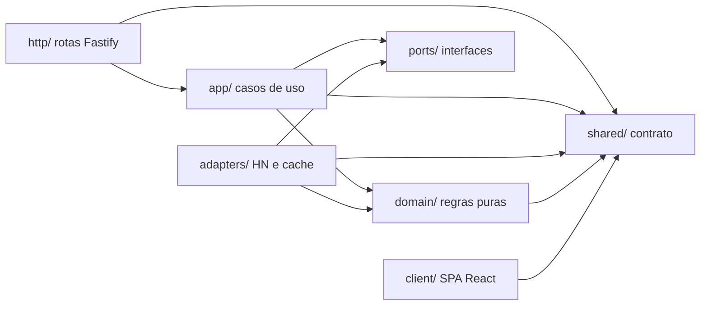
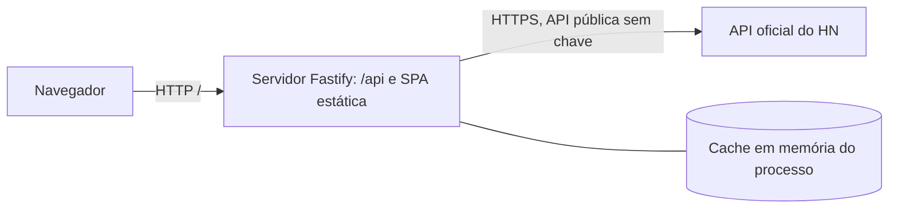

# Architecture Spine — hn-modernizacao

## Paradigma de Projeto

**Backend-for-Frontend (BFF) com back-end em portas e adaptadores (hexagonal).**

- O front-end é uma SPA que conhece apenas `/api`. Nunca fala com a API do HN.
- O back-end tem quatro camadas com nomes fixos:
  - `domain/`: regras puras (normalização, status, árvore de comentários, domínio do link, sanitização).
  - `ports/`: interfaces do cliente HN e do cache.
  - `adapters/`: implementações concretas das portas (cliente HTTP do HN, cache em memória).
  - `app/`: casos de uso. É o único lugar que orquestra cache, HN e domínio.
  - `http/`: rotas Fastify, mapeamento de erros e serialização.

## Invariantes e Regras

Direção de dependência permitida. Setas significam "pode importar". Qualquer outra importação é violação.



### AD-1 — Direção de dependência

- **Binds:** todo o back-end (`server/`), RNF-06
- **Prevents:** regras de negócio acopladas ao Fastify ou ao cliente HN, o que impede os testes unitários exigidos, e rotas lendo o cache ou o HN diretamente.
- **Rule:** `http/` é a única camada que importa Fastify. `http/` importa só `app/` e `shared/`; nunca `ports/` nem `adapters/`. `domain/` não importa de `app/`, `ports/`, `adapters/`, `http/` nem de bibliotecas de I/O. `ports/` só declara interfaces. Só `adapters/` importam o cliente HN ou a implementação de cache. Para o estado do serviço, `http/health` chama o caso de uso `getHealth` em `app/`. A regra é verificada por `eslint-plugin-import` com `no-restricted-paths`, configurado em `server/eslint.config.*` e rodado em CI.

### AD-2 — Fronteira do formato HN

- **Binds:** RF-03, RF-04, RF-10, R-03
- **Prevents:** o formato bruto da API vazando para além do adaptador; dois consumidores interpretando o mesmo campo de formas diferentes; mudança de formato do HN passando sem aviso, ou derrubando a resposta inteira.
- **Rule:**
  - O formato bruto só é tipado e parseado em `adapters/hn/`, com um validador de schema (biblioteca nomeada na Pilha).
  - Há duas categorias distintas. **Forma inválida** (campo obrigatório `id` ou `type` ausente, ou tipo errado) descarta só aquele item, registra log estruturado e incrementa um contador. **Ausência** (`url`, `score`, `kids`, `text`) é campo opcional e vira `null` ou lista vazia, nunca erro.
  - `url` só é aceita se usar `http:` ou `https:`. Caso contrário, vira `null` na normalização.
  - Títulos e textos do HN são decodificados de entidades HTML (`&amp;`, `&#x27;`) em `domain/`, para que `title` seja texto simples.
  - O status (`ok`, `deleted`, `dead`) é derivado em `domain/` a partir dos campos do item.
  - Comentários `deleted`/`dead` preservam o autor conhecido quando disponível; o marcador textual é neutro (`[removido]`/`[morto]`) e não atribui a ação/estado ao autor.

### AD-3 — Contrato compartilhado

- **Binds:** RF-10, RF-11, RNF-05, R-03
- **Prevents:** front e back declarando formatos separadamente; campos de tempo, obsolescência e truncamento sem fonte definida; texto e HTML tratados como o mesmo tipo.
- **Rule:**
  - `shared/contract/` é a única fonte dos tipos de resposta, dos códigos de erro e das constantes que ambos os lados precisam nomear. Nenhum tipo de resposta é redeclarado em outro lugar, nem copiado.
  - Mecanismo: `tsconfig` com `paths` `@shared/*` nos dois lados, e alias equivalente no Vite. O Dockerfile copia `shared/` junto com `server/` e `client/`.
  - Tipos de texto são marcados: `plain` (texto simples, renderizado como texto) ou `html` (sanitizado conforme AD-6). Campos `plain`: `Story.title`, `Story.author`, `Story.domain`, `CommentNode.author`. Campo `html`: `CommentNode.text`.
  - Envelopes de resposta:
    - `StoriesPage { items: ListingItem[], page, limit, snapshot, cachedAt, stale, hasMore? }`, com `ListingItem = Story | Job` discriminado por `type`; metadados não aplicáveis de `Job` são `null` e ele não é convertido em `Story`.
    - `snapshot` identifica a lista de IDs da categoria retida no cache (seu timestamp de lista); não é o `cachedAt` agregado da página, que pode refletir itens mais antigos. `hasMore` pode estar ausente/desconhecido; ausência não significa fim.
    - `ItemResponse { item: Story | Comment | Job, cachedAt, stale }`.
    - `CommentsResponse { nodes: CommentNode[], truncated, cachedAt, stale }`.
    - `Health { status, cache: { entries } }`.
    - `Story` e `Job` incluem `cachedAt` do item, como no contrato compartilhado.
  - `CommentNode.children` é `CommentNode[]` quando o nível foi buscado, `null` quando a expansão é cortada pela profundidade solicitada ou pelo orçamento de nós, e `[]` para folha real. `truncated` indica limite de orçamento de nós; o corte por profundidade não inventa nó nem campo/nível sintético.
  - Códigos de `ApiError.code`: `BAD_REQUEST`, `NOT_FOUND`, `ROUTE_NOT_FOUND`, `SNAPSHOT_EXPIRED`, `UPSTREAM_UNAVAILABLE`, `UPSTREAM_TIMEOUT`, `INTERNAL`. O cliente também produz `NETWORK_ERROR` e `TIMEOUT` ao falhar antes de chegar ao servidor. A lista só muda por alteração de `shared/contract`.

### AD-4 — Cache com dono único

- **Binds:** RNF-02, O-02, RF-11, R-06
- **Prevents:** duas rotas ou duas travessias buscando o mesmo item do HN e gravando versões com idades diferentes; uma entrada vencida ser descartada antes de servir de fallback.
- **Rule:**
  - A porta de cache (`ports/cache.ts`) expõe três operações: `get(key)` (só entradas frescas), `getWithStaleness(key)` (devolve `{ value, expired }`, incluindo entradas vencidas ainda retidas) e `set(key, value, ttl)`. Entradas vencidas são retidas por uma janela configurável (AD-9) antes de serem descartadas.
  - Só `app/` chama a porta de cache. `adapters/hn/` nunca lê nem escreve cache.
  - Só `app/` escreve `item:ID` e `list:CATEGORIA`. Chaves e TTL são definidos em um único módulo de `app/`.
  - O cache guarda o modelo normalizado e sanitizado, com `cachedAt`.

### AD-5 — Saída única para o HN e travessia única de comentários

- **Binds:** RNF-01, RNF-03, R-01, R-02, R-03, R-04, RF-05
- **Prevents:** requisições sem controle (N+1); chamadas penduradas; retentativas em cascata; duas travessias de comentários contando profundidade e nós de forma diferente; truncamento silencioso.
- **Rule:**
  - `adapters/hn/` expõe apenas `fetchItem(id)` e `fetchList(category)`. Cada uma faz uma requisição por chamada, com timeout, retentativas limitadas com backoff, e concorrência limitada e configurável. Requisições idênticas em voo são unificadas (single-flight).
  - A travessia de comentários é uma única função em `app/comments`. Ela busca nível a nível chamando `fetchItem` por nó, aplica o limite de profundidade e o limite de nós (AD-9), representa ramos não buscados com `children: null` e marca `truncated` quando o orçamento de nós é atingido (não apenas no corte por profundidade).
  - Falha do HN: `app/` tenta `getWithStaleness`. Se há entrada vencida, devolve com `stale: true`. Se não há, lança `UPSTREAM_UNAVAILABLE`. Falha por timeout lança `UPSTREAM_TIMEOUT` quando não há entrada vencida.

### AD-6 — Sanitização na fronteira

- **Binds:** RNF-10, RF-06, R-05
- **Prevents:** HTML não sanitizado chegando ao navegador por um caminho alternativo; sanitizador dependente de DOM quebrando a regra de AD-1.
- **Rule:**
  - O HTML dos comentários (`CommentNode.text`) é sanitizado uma única vez, na normalização em `domain/`, com lista de tags e atributos permitidos. O sanitizador é de parsing puro, sem DOM, e fica na lista de bibliotecas permitidas em `domain/`.
  - Campos `plain` nunca passam pelo sanitizador HTML.
  - O cliente renderiza `CommentNode.text` por um único componente, `client/src/components/SafeHtml`. Nenhum outro componente usa renderização de HTML bruto.
  - Atributo `href` vem de `Story.url`, já validado em AD-2. O cliente não monta `href` a partir de outro campo.

### AD-7 — Erros

- **Binds:** RF-08, seção 7 do PRD
- **Prevents:** formatos de erro diferentes por rota; erros do próprio Fastify (rota inexistente, JSON inválido, 415, 429 de plugin) chegando ao cliente em outro formato.
- **Rule:**
  - Toda falha sai como `{ "error": { "code", "message" } }`, produzida por um único mapeador em `http/errors.ts`, registrado como `setErrorHandler` e `setNotFoundHandler` raiz. Nenhum erro sai do Fastify sem passar por ele.
  - Erros do HN viram códigos de `shared/contract` em `app/`, antes de chegar a `http/`.

### AD-8 — Acesso a dados no front

- **Binds:** RF-08, RF-11, RF-12, RNF-05
- **Prevents:** componentes chamando `fetch` diretamente; estados de carregamento, erro e vazio implementados de formas diferentes; falha de rede tratada como texto de corpo; perda de rolagem e de paginação ao navegar.
- **Rule:**
  - Componentes não chamam `fetch`. Todo acesso à API passa por `client/src/api/`, com um hook por recurso (lista, item, comentários). Cada hook devolve `{ data, loading, error }`, em que `error` é sempre `ApiError` tipado.
  - Um único tradutor em `client/src/api/errors.ts` converte falha de rede e timeout do navegador em `ApiError` com `NETWORK_ERROR` ou `TIMEOUT`.
  - Estado de paginação e de rolagem da listagem fica em um `ListingProvider` acima das rotas, sobrevivendo à navegação para o detalhe e de volta.
  - Não há biblioteca de cache de consultas no cliente no MVP. O cache de dados é só do servidor (AD-4). Estado de tela, como tema e filtro, fica em contexto próprio ou local.

### AD-9 — Configuração e constantes

- **Binds:** RNF-07, RNF-08, RF-02
- **Prevents:** constantes espalhadas; cliente e servidor com padrões diferentes para o mesmo valor.
- **Rule:**
  - O back-end lê variáveis de ambiente só em `server/src/config/`, validadas na inicialização. `.env.example` documenta cada variável. Não há segredos no repositório.
  - Tamanho de página padrão, profundidade padrão de comentários (8), limite de nós, TTLs, janela de retenção de vencidos e concorrência são configuração do servidor; valores máximos permanecem configuráveis.
  - O cliente não hardcoda esses valores. Ele omite `limit` e `depth` quando não tem preferência, e o servidor aplica o padrão e devolve o valor efetivo (`limit` no `StoriesPage`).

### AD-10 — Testes por camada

- **Binds:** RNF-06, O-03, O-04
- **Prevents:** regras de negócio testadas só por integração lenta e frágil; ausência de teste de contrato com a API do HN.
- **Rule:** `domain/` tem testes unitários sem rede. `adapters/hn/` tem teste de integração contra um stub local com fixtures gravadas. `app/comments` tem teste da travessia com limites de profundidade e de nós. Esses testes e a auditoria axe são executados localmente; não se pressupõe gate de CI. Axe é evidência automatizada parcial, não comprova conformidade WCAG completa nem substitui avaliação humana de teclado/tecnologia assistiva.

### AD-11 — Paginação com snapshot

- **Binds:** RF-02, RF-12, RF-11
- **Prevents:** a lista anexada duplicando ou pulando histórias quando a entrada de lista expira entre a página 1 e a página 2.
- **Rule:** a primeira página fixa o `snapshot` (timestamp da entrada `list:CATEGORIA`, identidade da lista de IDs), distinto do `cachedAt` agregado da página. O cliente envia esse `snapshot` nas páginas seguintes. Enquanto a mesma entrada existir, inclusive como stale retida, o servidor serve as páginas a partir dela; `hasMore` é opcional e, quando fornecido, deriva dos IDs da categoria antes de filtrar itens ausentes/não exibíveis. Cliente não infere fim pela quantidade de `items`. Se a entrada não existe mais, o servidor responde `410 SNAPSHOT_EXPIRED`, e o cliente reinicia a listagem na página 1 sem token antigo, com aviso de atualização.

## Convenções de Consistência

| Preocupação | Convenção |
| --- | --- |
| Nomes | Código e identificadores em inglês; textos da interface, mensagens e documentação em português (PT-BR). Arquivos em kebab-case; componentes React em PascalCase. |
| Dados e formatos | IDs numéricos como vêm do HN. Datas no contrato em ISO 8601. Tempo relativo é formatado no cliente por função pura testada em `shared/format`. |
| Estado e transversais | Erros conforme AD-7. Logs estruturados pelo logger do Fastify. Sem autenticação no MVP. Configuração conforme AD-9. |

## Pilha

Versões verificadas na web em 09/10/2026, quando indicado. Itens marcados `[ASSUNÇÃO]` ainda não foram confirmados e devem ser fixados com o gerenciador de pacotes antes de travar.

| Nome | Versão |
| --- | --- |
| Node.js (runtime do back-end e ferramentas) | 24 LTS (verificado; ver Adiado) |
| React | 19.2.8 (verificado no npm; linha 19.2 escolhida, ver Adiado) |
| Vite (bundler e servidor de desenvolvimento) | 8.3.x (verificado no registro npm) |
| TypeScript, modo estrito | 7.0.x (verificado no registro npm) `[ASSUNÇÃO: confirmar compatibilidade com lint e ferramentas]` |
| Fastify (framework HTTP) | 5.12.x (verificado no registro npm) |
| Zod (validação de schema do HN, AD-2) | `[ASSUNÇÃO: versão não verificada]` |
| sanitize-html ou equivalente de parsing puro (AD-6) | `[ASSUNÇÃO: versão não verificada]` |
| ESLint com eslint-plugin-import (AD-1) | `[ASSUNÇÃO: versão não verificada]` |
| Vitest (testes) | 5.0.x (verificado no registro npm) |
| axe-core (auditoria de acessibilidade em CI) | 4.14.x (verificado no registro npm) |
| Docker Compose | v5 `[ASSUNÇÃO: fonte secundária]` |

Starter: template `react-ts` do `create-vite`, que é um template básico da Vite e não um gerador oficial de aplicação `[ASSUNÇÃO: confirmar o package.json gerado]`. O back-end é montado à mão, sem gerador.

## Seed estrutural

### Visão de contêineres e execução



- **Desenvolvimento:** Vite serve a SPA na porta 5173 e encaminha `/api` para o Fastify na porta 3000.
- **Docker Compose:** um serviço só. O servidor Fastify serve o build estático da SPA e a API na porta 3000. O build copia `shared/`, `server/` e `client/`.
- **Operação:** `/api/health` informa o estado do serviço e do cache. Logs vão para a saída padrão.

### Árvore de código (seed)

```text
hn-modernizacao/
  shared/
    contract/        # tipos de resposta, envelopes e códigos de erro (AD-3)
    format/          # tempo relativo, função pura e testada
  server/
    src/
      domain/        # regras puras, sem I/O (AD-1, AD-2, AD-6)
      ports/         # interfaces do HN e do cache (AD-1, AD-4)
      adapters/
        hn/          # cliente único da API do HN (AD-2, AD-5)
        cache/       # cache em memória com TTL e retenção de vencidos (AD-4)
      app/           # casos de uso, travessia de comentários, getHealth (AD-4, AD-5, AD-11)
      http/          # rotas Fastify, mapeador de erros (AD-1, AD-7)
      config/        # variáveis de ambiente validadas (AD-9)
  client/
    src/
      api/           # hooks por recurso e tradutor de erros (AD-8)
      features/      # listagem, detalhe, ListingProvider; busca local (RF-09) fica parked para eventual retomada (AD-8)
      components/    # SafeHtml, único componente de HTML (AD-6)
  docker-compose.yml
  Dockerfile
  .env.example
  README.md
```

## Mapa de capacidades para arquitetura

| Capacidade / área | Onde vive | Governada por |
| --- | --- | --- |
| RF-01, RF-02 Listagem e paginação | `app/` (listas), `client/src/features/` (página e `ListingProvider`) | AD-4, AD-5, AD-9, AD-11 |
| RF-03 Metadados da história | `domain/` (normalização, domínio do link), `shared/contract` | AD-2, AD-3 |
| RF-04, RF-05, RF-06 Árvore de comentários | `app/comments`, `domain/` (árvore e status), `client/src/features/` | AD-2, AD-5, AD-6 |
| RF-07 Tema claro e escuro | `client/src/features/` (contexto de tema) | AD-8 |
| RF-08 Carregamento, erro e vazio | `client/src/api/`, `http/errors.ts` | AD-7, AD-8 |
| RF-09 Busca local (opcional, parked; fora do corte atual) | Não há implementação comprometida no MVP; se retomado, `client/src/features/` (filtro sobre dados carregados) | AD-8 |
| RF-10 Dados normalizados | `adapters/hn/`, `domain/`, `shared/contract` | AD-2, AD-3 |
| RF-11 Atualizado em e dado vencido | `adapters/cache/`, envelopes (`cachedAt`, `stale`) | AD-3, AD-4, AD-5 |
| RF-12 Rolagem e paginação preservadas | `client/src/features/` (`ListingProvider`), `app/` (snapshot) | AD-8, AD-11 |
| RF-13 Estado vazio | `client/src/features/`, `shared/contract` | AD-3, AD-8 |
| RNF-01, RNF-02, RNF-03 Desempenho e cache | `app/`, `adapters/cache/`, `adapters/hn/` | AD-4, AD-5 |
| RNF-04, RNF-09 Acessibilidade e responsividade | `client/src/components/` | AD-10 (automação local e avaliação humana separada) |
| RNF-05 Tipagem estrita | Todo o projeto | AD-3 |
| RNF-06 Testes | `domain/`, `adapters/hn/`, `app/comments` | AD-1, AD-10 |
| RNF-07, RNF-08 Configuração e execução | `server/src/config/`, `docker-compose.yml`, `Dockerfile`, `.env.example` | AD-9 |
| RNF-10 Sanitização | `domain/` (sanitização), `client/src/components/SafeHtml` | AD-6 |

## Adiado

- **Hospedagem em produção e provedor de CI/CD.** O MVP roda local e por Docker Compose. Decidir depois do MVP.
- **Linha do Node.js.** Fica no Node 24 LTS. A Active LTS do 24 termina em 20/10/2026, e o Node 26 vira LTS em 28/10/2026. Reavaliar nessa data; a troca é uma decisão de pilha, sem efeito nas ADs.
- **Linha do React.** Fica na 19.2. Existe a 19.3, mas a troca fica para depois do MVP.
- **Valores concretos:** TTLs, janela de retenção de vencidos, concorrência padrão, profundidade padrão, limite de nós e tamanho de página padrão. Definir no plano técnico com base nos testes de carga (R-01, R-02).
- **Tamanho máximo da lista de IDs e limite de taxa do HN.** Pendências do PRD, a verificar antes do plano técnico. Não bloqueiam o desenho, porque o cliente pagina e limita a concorrência.
- **Roteamento do front-end.** Decidir no plano técnico, dentro da regra de AD-8.
- **Observabilidade além de `/api/health`.** Métricas e rastreamento ficam para depois do MVP.
- **Sistema visual e estilo.** Definir a partir do documento de UX.
- **Persistência, autenticação, tempo real, SSR.** Fora do MVP, conforme o PRD.
