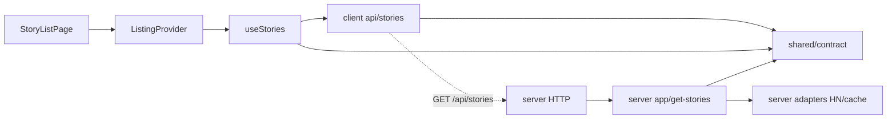

# Architecture Spine — Home: scroll infinito e cores

## Design Paradigm

**Arquitetura em camadas orientada a features**, mantendo as fronteiras do produto existente. `[ADOPTED]` identifica contratos existentes ou requisitos definidos no PRD; `[ASSUMPTION]` identifica decisões técnicas propostas no caminho rápido, a ratificar ao adotar a spec. Finalizar este documento não aprova A1/A2 nem autoriza implementação.

Setas sólidas são dependências permitidas; a pontilhada é transporte HTTP. `shared/contract` não depende de client ou server. Código do browser não depende de módulos do server nem acessa Hacker News diretamente.

## Invariants & Rules

### AD-1 — Donos de estado e fronteiras [ADOPTED]

- **Binds:** todas as áreas desta fatia.
- **Prevents:** duas fontes de páginas, transporte paralelo ou UI conhecendo a fonte HN.
- **Rule:** `ListingProvider` mantém rota, categoria e retorno; sua instância de `useStories` mantém páginas, requisições e política de continuação. `StoryListPage` apresenta e envia comandos; `api/stories` só transporta; `shared/contract` define o contrato; server app/adapters continuam donos da classificação recebida e do cache. O observador não mantém páginas, cursores, erros ou retries próprios. A direção de dependências do diagrama é vinculante.

### AD-2 — Um comando de continuação e uma política automática [ASSUMPTION]

- **Binds:** FR-1, FR-2, FR-3, FR-5, NFR-3.
- **Prevents:** corrida entre botão e sentinela, retries invisíveis e carregamento de todo o feed.
- **Rule:** uma sentinela com `IntersectionObserver` sinaliza o mesmo comando usado pelo botão, distinguindo origem automática/manual. O dono `useStories` valida **no máximo uma carga incremental em voo por geração**, com chave `categoria:snapshot:página`; chamadas concorrentes não iniciam outro pedido. Manual e automático compartilham as guardas de sequência/carga/fim. Sem suporte ao observador, permanece o manual. Desconectar observação ao sair da home e na limpeza; não iniciar páginas por timer, detalhe ou mera renderização.

O automático exige simultaneamente: home ativa e restauração concluída; ausência de carga inicial/incremental, erro, reinício em voo ou pausa; `hasMore === true`; último lote aceito com pelo menos um ID inédito. O aviso persistente `snapshotExpired` não é, sozinho, um reinício em voo. Cada episódio de interseção dispara no máximo um lote. Após o commit/layout de um lote, registrar uma nova posição-base; o próximo sinal válido é **saída/reentrada da sentinela** ou, se ela continuar visível, **rolagem do viewport para `scrollY` maior que essa base, causada por wheel/touchmove/tecla de rolagem recebida depois daquele commit**. Mudanças de layout, restauração, scroll programático e observer recriado não são novos sinais. Sinais recebidos enquanto ocupado não ficam enfileirados para disparar ao terminar a carga.

| Resultado da continuação | Política única |
| --- | --- |
| `hasMore === false` | Fim confirmado; nenhuma nova continuação, inclusive manual. |
| `hasMore` ausente | Somente “Carregar mais”; não inferir disponibilidade. |
| Lote aceito sem IDs inéditos, mesmo com `hasMore === true` | Avançar página aceita e pausar automático; manter manual. |
| Falha incremental | Preservar páginas; pausar automático; “Tentar novamente” repete a mesma continuação. |
| Manual bem-sucedido, com inéditos e `hasMore === true` | Liberar pausa de erro/vazio/desconhecido; não liberar pausa voluntária nem proteção de foco ainda ativa. |
| Pausa voluntária | Persistir na sequência até “Retomar automático”; retomar não vence bloqueios de dados/foco. |
| Foco em controle ameaçado pelo append | Proteger enquanto o foco permanecer nessa região; rearmar só após saída deliberada do foco e novo gatilho. |

A política persiste junto à sequência, não em estado descartável da página de apresentação. `useStories` é dono do gate efetivo; `ListingProvider` fornece rota/restauração e a UI fornece proteção de foco/pausa voluntária. Todo sinal e comando carrega o escopo vigente de sequência **e ciclo de navegação/restauração**; sinais antigos não reabrem o gate nem iniciam pedidos. Fechar o gate antes de publicar mudança de rota ou iniciar restauração; reabri-lo somente após a transição de leitura pronta de AD-5.

### AD-3 — Sequência por snapshot, não por quantidade visível [ADOPTED]

- **Binds:** FR-1, FR-2, FR-3, NFR-3.
- **Prevents:** mistura de listas, falso fim e cursor baseado em notícias filtradas.
- **Rule:** continuar com categoria, `snapshot` e `limit` da primeira página e `page = última página aceita + 1`. `cachedAt` exibido é frescor, não cursor. Aceitar somente resposta da geração/categoria ativas, com snapshot, limite e página esperados; página duplicada não reaplica conteúdo. Página vazia aceita avança o número; erro não avança. **Somente `hasMore === false` confirma fim**: o servidor fatia IDs antes de filtrar itens indisponíveis, por isso lote curto/vazio não prova fim. Troca de feed ou atualização explícita invalida geração e cancela pedidos antigos antes de aceitar novos resultados.

`SNAPSHOT_EXPIRED`/HTTP 410 invalida a sequência inteira: substituir por uma nova página 1 sem snapshot e anunciar reinício; nunca acrescentar a nova sequência à antiga. Abortar é complementar à checagem de geração, não seu substituto.

### AD-4 — Uma projeção estável dos itens [ASSUMPTION]

- **Binds:** FR-1, FR-3, FR-4.
- **Prevents:** deduplicações incompatíveis, reordenação e perda do cursor em lotes vazios.
- **Rule:** `useStories` combina páginas aceitas na ordem recebida e expõe cada `ListingItem.id` uma única vez, preservando a primeira ocorrência. As páginas e seus metadados permanecem aceitos mesmo quando a projeção não acrescenta itens; o cursor nunca deriva da contagem visível. Contar IDs inéditos por lote para AD-2. Preservar o prefixo já renderizado, as keys por ID e a ordem da fonte; não reclassificar notícias. A guarda atual de páginas duplicadas não substitui esta regra de IDs.

### AD-5 — Restauração e efeitos de leitura têm autoridade única [ASSUMPTION]

- **Binds:** FR-1, FR-3, FR-4.
- **Prevents:** append puxando a tela para trás, efeitos na janela do detalhe e dois restauradores competindo.
- **Rule:** manter `useStories` montado pelo `ListingProvider` ao abrir detalhe, incluindo páginas e pausas da sequência. `ListingProvider` é a autoridade da posição de leitura; o hook comunica reinício, não altera scroll/foco. Sair da home ou iniciar restauração cancela **toda continuação incremental em voo, manual ou automática**, sem avançar cursor ou apagar páginas; aborto libera busy/chave apenas da requisição que ainda os possui. Resposta cancelada não pode aplicar conteúdo nem iniciar recuperação por 410 no detalhe.

A transição compartilhada de **leitura pronta** é ordenada: fechar gate/cancelar → renderizar páginas existentes → `ListingProvider` executar a restauração de posição → UI confirmar, após esse commit/ajuste, a proteção de foco vigente → `useStories` combinar esses sinais do mesmo escopo → rearmar observação. Agendar `requestAnimationFrame` ou limpar o pending antes de executar a restauração não é conclusão; a confirmação deve ocorrer após o ajuste efetivo. Qualquer sinal de outro ciclo é descartado. Saída de foco protegido ainda exige novo gatilho válido de AD-2.

Append automático não chama `scrollTo`, não restaura `scrollY` capturado no início da requisição e não desloca foco. A apresentação só revela/restaura o botão após ação **manual de teclado**, se ele ainda detém o foco; Tab ou mudança de rota invalida esse efeito. Feed novo, atualização explícita e expiração podem reiniciar posição; o reinício por expiração é anunciado, nunca aplicado à janela de um detalhe ativo. Continuidade é em memória na mesma sessão; não criar persistência após reload ou entre dispositivos.

### AD-6 — Continuação acessível e interrompível [ASSUMPTION]

- **Binds:** FR-2, FR-3, FR-5, NFR-2.
- **Prevents:** foco perseguindo controles, lista inteira reanunciada e conteúdo externo inalcançável.
- **Rule:** preservar `ol/li`, tabs e suas semânticas existentes; não adotar `role="feed"` sem seu contrato próprio. Manter continuação manual acessível sempre que a sequência puder continuar, mesmo quando o automático estiver habilitado. Anunciar carregamento adicional, falha e fim pelo estado/delta, não pela lista inteira. Em fim confirmado, apresentar “Você chegou ao fim”; manter os estados iniciais, stale e reinício distintos.

Disponibilizar uma ação acessível de pausar/retomar automático; a pausa voluntária persiste na sequência. Foco no fallback ou em controles após a lista cuja posição/acesso o append deslocaria suspende novos gatilhos e cancela carga automática em voo **antes de append**, preservando páginas/cursor; a ação manual continua permitida. A proteção de foco termina somente após saída deliberada dessa região; observar a mesma sentinela não a remove. Controles antes da lista não ativam essa proteção por si só. Retomar sob foco protegido só produz carga após esse foco sair da região e existir novo gatilho válido. Não criar rodapé novo; controles após a lista, quando existentes, continuam alcançáveis sem serem empurrados por carregamento automático.

### AD-7 — Tokens semânticos e comportamento de temas [ADOPTED]

- **Binds:** FR-6, FR-7, NFR-1, NFR-2.
- **Prevents:** cores isoladas por componente, estados apenas cromáticos e regressão no detalhe compartilhado.
- **Rule:** `theme.css` é dono dos tokens semânticos; `listing.css` aplica os usos da home. Tokens novos têm valores nos dois temas e na seleção por sistema; `ThemeProvider` e bootstrap permanecem donos da preferência por aba. Não criar temas, seletor paralelo ou paleta por categoria. A paleta aprovada em UX deve ter usos perceptíveis no cabeçalho, tab ativo e interações de links/controles; áreas de leitura seguem legíveis. Preservar título, origem e demais informações existentes das notícias, sem removê-las para acomodar decoração. Seleção tem indicação não cromática, erro tem texto e foco é visível.

Validar pares reais em ambos os temas: texto comum ≥4,5:1, grande ≥3:1 e sinais essenciais de controles/estados ≥3:1. Manter alvos de 44 px, reduced motion e home a 360 px/desktop sem overflow horizontal. Ampliar a checagem de contraste aos usos novos; os dez pares atuais de `check-theme.mjs` não demonstram conformidade de uma nova paleta. Tokens compartilhados exigem regressão visual/acessível do detalhe, sem alterar seu comportamento.

A interface semântica existente é `--surface-base`, `--surface-raised`, `--ink-primary`, `--ink-secondary`, `--primary`, `--primary-foreground`, `--primary-hover` e `--border-hairline`. Preservar esses nomes. Qualquer papel novo exige uma única tabela acordada de **nome → papel → valor claro/escuro**, ratificada em UX/spec antes de separar trabalho de tokens e consumidores; ambos usam essa mesma interface, sem aliases locais ou nomes inferidos por cada história.

### AD-8 — Mesmo envelope operacional [ADOPTED]

- **Binds:** toda a fatia, NFR-3.
- **Prevents:** scroll exigindo nova infraestrutura, sessão durável ou limites ampliados.
- **Rule:** preservar API paginada same-origin, erros, cache por processo, limites por lote e limites upstream existentes. O cliente usa o limite negociado da primeira página, sem ampliá-lo; defaults atuais são 30, máximo configurável até 50. Não adicionar fonte, serviço, DB, fila, analytics, autenticação, novo provider ou topologia de deploy. Não buscar todas as páginas antecipadamente nem continuar em background no detalhe. Runtime de build/validação da aplicação respeita Node ≥24; não baixar o requisito para acomodar o ambiente local.

## Stack — seed verificado em 2026-10-13

O lockfile é autoridade das versões, não esta tabela; nenhuma atualização de dependência faz parte da fatia.

| Name | Version |
| --- | --- |
| React / React DOM | 19.2.8 |
| Vite | 8.3.4 |
| Fastify | 5.12.5 |

## Structural Seed

Dev: Vite com proxy `/api` para Fastify. Produção: um processo Node 24 serve SPA e API, com cache em memória; build mantém `shared/dist`, `server/dist` e `client/dist` juntos. Snapshot não é sessão durável e não tem afinidade multi-instância garantida.

| Área do PRD | Onde implementar | Governa |
| --- | --- | --- |
| FR-1–FR-3, NFR-3 | `use-stories.ts`, `StoryListPage.tsx`; contrato/servidor preservados | AD-1–AD-4, AD-8 |
| FR-4 | `ListingProvider.tsx`, efeitos de apresentação/carga | AD-4, AD-5 |
| FR-5 | apresentação, comando/pausa da sequência e restauração | AD-2, AD-5, AD-6 |
| FR-6–FR-7, NFR-1–NFR-2 | `theme.css`, `listing.css`; preferência preservada | AD-6, AD-7 |

## Deferred

- **[ASSUMPTION A1] Seis feeds:** usar a mesma política em `top/new/best/ask/show/job`; confirmar abrangência antes de fatiar, sem criar feeds.
- **[ASSUMPTION A2] Direção azul e acentos:** escolher/aprovar paleta em UX antes de código visual; ratificar nomes e papéis de tokens novos antes de separar tokens/consumidores. Não bloqueia planejar scroll.
- **Propostas técnicas marcadas `[ASSUMPTION]`:** ratificar AD-2/4/5/6 ao adotar a spec, antes de build; não deixar cada história escolher política própria.
- **Detalhes locais:** margem/limiar da sentinela, nomes de flags e extração de hooks são livres desde que cumpram as guardas, pausas e autoridade de estado. Não exigem decisão compartilhada adicional.
- **Virtualização e teto de DOM:** fora desta entrega; revisitar apenas com problema medido, antes de remover itens ou mudar restauração/semântica.
- **Infra, novos ambientes/providers e múltiplas réplicas:** fora da fatia. Revisitar cache/snapshot e AD-3/8 antes de alterar topologia; não prometer escalabilidade horizontal neste contrato.

## Verification Boundary

A implementação deverá inverter o teste que hoje proíbe carregar ao rolar (`e2e/listing.spec.ts:338`), percorrer ≥3 lotes automáticos e manter cobertura de erro/retry, páginas vazias/desconhecidas, 410, feed trocado, detalhe/retorno, foco/teclado, temas e responsividade. Incluir rolagem durante resposta lenta, navegação/foco protegido durante pedido em voo, callback repetido e IDs repetidos entre páginas.

Esta entrega verifica a arquitetura, não executa a aplicação nem seus testes. Runtime local observado: Node 22.23.1, abaixo do requisito do projeto; validar implementação em Node ≥24. Contraste e conformidade WCAG não são resultados desta entrega.

## Fontes técnicas verificadas

Versões do seed: `package-lock.json`. Existência/compatibilidade das linhas: [React](https://react.dev/versions), [Vite 8](https://vite.dev/blog/announcing-vite8), [Fastify 5](https://fastify.dev/docs/latest/Guides/Migration-Guide-V5/), [Node](https://nodejs.org/en/about/previous-releases). Mecanismos e critérios: [IntersectionObserver](https://developer.mozilla.org/en-US/docs/Web/API/Intersection_Observer_API), [AbortController](https://developer.mozilla.org/en-US/docs/Web/API/AbortController), [semântica Feed](https://www.w3.org/WAI/ARIA/apg/patterns/feed/), [contraste textual](https://www.w3.org/WAI/WCAG22/Understanding/contrast-minimum.html) e [não textual](https://www.w3.org/WAI/WCAG22/Understanding/non-text-contrast.html). Racional, evidências e decisões de triagem ficam no `.memlog.md`.
