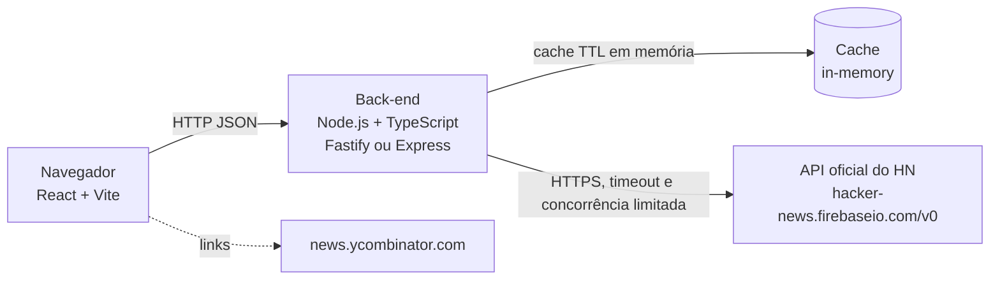

# Brief: Modernização da interface do Hacker News (MVP)

> Escrito para: time de produto e engenharia que vai especificar, planejar e construir o MVP.
> Marcações: [ASSUNÇÃO] = inferido, a validar. Perguntas em aberto estão no fim.

## 1. Visão geral e problema

O Hacker News (https://news.ycombinator.com) é um agregador de notícias técnicas com interface de 2000s: layout em tabela, pouca hierarquia visual, navegação densa e pouca adaptação a telas pequenas. O conteúdo e a comunidade são valiosos; a apresentação é o gargalo.

Este projeto cria uma interface moderna para o HN que consome a API oficial e pública (https://github.com/HackerNews/API, base `https://hacker-news.firebaseio.com/v0/`). O produto tem dupla finalidade:

1. Entregar uma leitura mais agradável do HN, com responsividade mobile first, tema claro/escuro e comentários em árvore navegáveis.
2. Servir de caso didático: demonstrar como conduzir um projeto greenfield do zero ao MVP com IA em cada etapa do SDLC.

Fora de escopo de produto: substituir o HN, criar uma comunidade paralela ou alterar o conteúdo original.

## 2. Objetivos e critérios de sucesso

| ID | Objetivo | Métrica | Meta MVP |
|---|---|---|---|
| O-01 | Listagem rápida | p95 da primeira página (`GET /api/stories`) com cache frio e quente | < 1 s em condições normais [ASSUNÇÃO: "condições normais" = rede doméstica e API do HN respondendo sem erro] |
| O-02 | Comentários sem N+1 | Chamadas à API do HN por visualização de história, com cache quente | Zero chamadas repetidas para itens já em cache dentro do TTL |
| O-03 | Acessibilidade | Verificações automatizadas e avaliação manual nas telas principais, com meta WCAG 2.1 AA | Sem violações críticas ou sérias conhecidas; automação não comprova conformidade WCAG completa e avaliação manual/AT é acompanhada separadamente |
| O-04 | Qualidade | Testes locais das regras de negócio e integração do back-end | Testes unitários das regras de negócio e ao menos 1 teste de integração executados localmente; não pressupõe gate de CI |
| O-05 | Caso didático | Artefatos de cada fase do SDLC produzidos e revisados | Todas as fases da seção 10 com artefato versionado |

## 3. Personas e casos de uso

**Personas**

- **Leitor frequente** [ASSUNÇÃO]: lê o HN diariamente, usa celular na maior parte do tempo, quer escanear títulos e abrir comentários sem perder a posição.
- **Leitor ocasional de Ask/Show** [ASSUNÇÃO]: entra por perguntas e projetos, quer ler comentários em profundidade.
- **Time de engenharia que estuda o projeto** (público didático): quer entender a arquitetura e o processo de IA no SDLC.

**Histórias de usuário**

- **US-01** Como leitor frequente, quero navegar entre as categorias top, new, best, ask, show e job, para encontrar rapidamente o que me interessa.
  - Dado que estou na home, quando seleciono "new", então vejo as histórias mais recentes com pontuação, autor, tempo relativo, número de comentários e domínio.
  - Dado que a categoria "job" não tem itens, quando a abro, então vejo o estado vazio com mensagem clara.

- **US-02** Como leitor frequente, quero carregar mais histórias sem perder a posição de rolagem, para continuar lendo sem recomeçar.
  - Dado que estou no fim da lista, quando acione "carregar mais" ou a lista chegue ao fim, então novas histórias são anexadas e a posição permanece.
  - Dado que a API falha na página seguinte, quando tento carregar mais, então vejo erro com opção de tentar de novo, e as histórias já carregadas continuam visíveis.

- **US-03** Como leitor ocasional, quero abrir uma história e ver os comentários em árvore, para acompanhar as discussões.
  - Dado que abro uma história com comentários, quando a página carrega, então vejo os comentários de primeiro nível com autor e tempo relativo.
  - Dado que um comentário tem respostas, quando clico em "recolher", então suas respostas somem; ao clicar em "expandir", reaparecem.
  - Dado que um comentário foi removido ou está morto (`deleted` ou `dead`), quando a árvore é renderizada, então ele aparece como marcador neutro "[removido]" ou "[morto]", sem quebrar a hierarquia; autor conhecido é preservado e o marcador não lhe atribui remoção/estado.

- **US-04** Como leitor frequente, quero alternar entre tema claro e escuro, para ler confortavelmente em qualquer ambiente.
  - Dado que o sistema está em modo escuro, quando abro o app pela primeira vez, então o tema escuro é aplicado; a escolha manual persiste na sessão.

- **US-05** Como leitor frequente, quero usar a interface no celular, para ler no transporte.
  - Dado uma tela de 375 px de largura, quando abro a listagem, então não há rolagem horizontal e os alvos de toque têm pelo menos 44 px.

- **US-06** Como leitor frequente, quero que a interface informe quando algo está carregando, falhou ou está vazio, para não ficar sem resposta.
  - Dado uma requisição em andamento, quando a lista é exibida, então vejo indicador de carregamento acessível (`aria-busy`, texto para leitor de tela).

- **US-07** (opcional, parked; fora do corte atual e não bloqueia o MVP) Como leitor frequente, quero buscar nos itens já carregados, para filtrar por palavra no título.
  - Dado que carreguei 60 itens, quando digito "rust", então vejo apenas os que contêm "rust" no título, sem nova chamada à API; o comportamento só será retomado se o requisito parked sair do estacionamento.

## 4. Escopo do MVP

**Incluído**

- Listagem por categorias: top, new, best, ask, show, job.
- Paginação ou carregamento incremental, com contagem de itens por página definida em configuração.
- Detalhe da história com comentários em árvore, recolher e expandir.
- Metadados: pontuação, autor, tempo relativo, número de comentários, domínio do link.
- Tema claro/escuro e layout responsivo mobile first.
- Estados de carregamento, erro e vazio.
- Back-end com cache em memória com TTL e agregação sobre a API oficial.
- Configuração por variáveis de ambiente e README de execução local.

**Opcional e parked (fora do corte atual; não bloqueia o MVP)**

- Busca local simples sobre os itens já carregados (US-07 / RF-09), sem nova chamada à API.

**Excluído do MVP**

- Autenticação e contas de usuário.
- Votação, comentários e submissão de histórias.
- Banco de dados de produção (cache apenas em memória).
- SSR avançado.
- Internacionalização.

**Futuro (após o MVP)**

- Persistência em banco para histórico e métricas.
- Busca no servidor com índice próprio.
- Atualização em tempo real via endpoint `/v0/updates.json` ou polling configurável.
- SSR ou pré-renderização para SEO.
- Internacionalização.

## 5. Requisitos

**Funcionais**

- **RF-01** O sistema deve listar itens por categoria (top, new, best, ask, show, job) a partir dos endpoints de lista da API oficial. O contrato é `ListingItem = Story | Job`, discriminado por `type`; Job permanece Job.
- **RF-02** O sistema deve paginar a listagem, retornando até N itens por página (N configurável, padrão 30 [ASSUNÇÃO]).
- **RF-03** O sistema deve exibir para cada item os metadados disponíveis: título, pontuação, autor, tempo relativo, número de comentários e domínio do link (derivado de `url`). Campos ausentes ou não aplicáveis — incluindo `url`, `domain`, `author`, `score` e `createdAt` — são representados por `null` conforme o contrato compartilhado.
- **RF-04** O sistema deve abrir uma história com a árvore de comentários a partir dos `kids` do item.
- **RF-05** O usuário deve poder recolher e expandir cada nó da árvore de comentários.
- **RF-06** O sistema deve exibir marcador neutro "[removido]" para comentários `deleted` e "[morto]" para `dead`, sem interromper a árvore. Preservar autor conhecido sem atribuir a ele a remoção ou o estado `dead`.
- **RF-07** O sistema deve alternar entre tema claro e escuro e lembrar a escolha na sessão do navegador.
- **RF-08** O sistema deve exibir estados de carregamento, erro (com nova tentativa) e vazio em listagem e detalhe.
- **RF-09** (opcional, parked; fora do corte atual e não bloqueia o MVP) O sistema poderá filtrar localmente, por título, os itens já carregados.
- **RF-10** O back-end deve expor os dados normalizados (seção 7) e não repassar o formato bruto da API.

**Não funcionais**

- **RNF-01** Primeira página de listagem em menos de 1 s (p95) em condições normais, com cache quente.
- **RNF-02** O back-end deve servir itens repetidos a partir do cache em memória dentro do TTL configurado, evitando novas chamadas à API oficial.
- **RNF-03** A montagem da árvore de comentários não deve gerar requisições N+1 sem controle: as buscas de itens devem ser feitas em lote, com limite de concorrência configurável e reaproveitamento do cache.
- **RNF-04** Meta de acessibilidade alinhada à WCAG 2.1 AA: contraste mínimo de 4.5:1 para texto normal nos dois temas, navegação completa por teclado, rótulos acessíveis em controles e foco visível. Verificações automatizadas são evidência parcial e não comprovam, isoladamente, conformidade WCAG completa; avaliação humana com tecnologia assistiva é separada.
- **RNF-05** Código tipado (TypeScript em modo estrito) nos dois lados.
- **RNF-06** Testes unitários nas regras de negócio (normalização de itens, montagem da árvore, cálculo do tempo relativo, extração de domínio) e pelo menos um teste de integração do back-end contra a API do HN (ou um stub dela).
- **RNF-07** Configuração por variáveis de ambiente, sem valores sensíveis no repositório.
- **RNF-08** README com instruções de execução local e de execução via Docker Compose.
- **RNF-09** Layout responsivo sem rolagem horizontal em larguras a partir de 320 px.

## 6. Restrições e premissas

**Restrições da API do HN**

- A API é pública e não tem autenticação; os dados são de leitura.
- Não há SLA publicado. Qualquer comportamento de disponibilidade, latência ou taxa de requisições é incerto e deve ser tratado com timeouts, retentativas limitadas e degradação para dados em cache.
- O endpoint `topstories`, `newstories` e similares retorna listas de IDs (até cerca de 500 [ASSUNÇÃO: verificar o limite atual na documentação]); cada item exige uma requisição `item/{id}.json`.
- Itens podem ter `deleted`, `dead`, ou não ter `url`, `score` ou `kids`. A interface deve tolerar esses campos ausentes.
- Não há limite de taxa documentado [ASSUNÇÃO: confirmar antes de implementar; tratar como risco].
- Os dados mudam continuamente (pontuação e número de comentários). O cache com TTL aceita dados levemente desatualizados e isso deve ser exibido ou documentado.

**Premissas**

- [ASSUNÇÃO] A API oficial continuará disponível e com o formato atual durante o desenvolvimento do MVP.
- [ASSUNÇÃO] O projeto é de uso pessoal e didático, sem tráfego de produção significativo. Por isso o cache em memória de instância única basta.
- [ASSUNÇÃO] Não há requisito legal ou de marca para exibir o conteúdo com layout diferente do original, desde que a fonte e os links para o HN sejam mantidos.
- [ASSUNÇÃO] Os links de comentários e de histórias apontam para os endereços originais do HN.
- Sem autenticação: o MVP não identifica usuários e não guarda estado por usuário no servidor.

## 7. Arquitetura

### 7.1 Visão de alto nível



### 7.2 Contratos de API do back-end (propostos)

Base: `/api`. Respostas em JSON. Erros no formato `{ "error": { "code": "...", "message": "..." } }`.

| Método | Caminho | Descrição | Parâmetros |
|---|---|---|---|
| GET | `/api/stories` | Lista itens `Story | Job` de uma categoria | `category` (top, new, best, ask, show, job; padrão top), `page` (≥ 1, padrão 1), `limit` (1–50, padrão 30), `snapshot` (obrigatório após página 1) |
| GET | `/api/items/{id}` | Detalhe de um item (história, comentário ou job) | — |
| GET | `/api/items/{id}/comments` | Árvore de comentários de uma história | `depth` (padrão 8; máximo configurável) |
| GET | `/api/health` | Status do serviço e do cache | — |

Exemplo de resposta de `GET /api/stories?category=new&page=1&limit=2`:

```json
{
  "page": 1,
  "limit": 2,
  "snapshot": "2026-10-09T10:00:05Z",
  "items": [
    {
      "id": 123,
      "type": "story",
      "title": "Exemplo de título",
      "url": "https://exemplo.com/artigo",
      "domain": "exemplo.com",
      "author": "usuario",
      "score": 42,
      "commentCount": 17,
      "createdAt": "2026-10-09T10:00:00Z",
      "cachedAt": "2026-10-09T09:59:00Z"
    }
  ],
  "cachedAt": "2026-10-09T09:59:00Z",
  "stale": false,
  "hasMore": true
}
```

`ListingItem = Story | Job` é discriminado por `type`; metadados ausentes ou não aplicáveis são `null` conforme o contrato. `snapshot` identifica o timestamp/versão da lista de IDs no cache e é distinto do `cachedAt` agregado dos itens da página, que pode ser anterior. `hasMore` é opcional: se ausente, o fim é desconhecido. Quando presente, deriva dos IDs da categoria antes de filtrar itens ausentes ou não exibíveis; o cliente não infere o fim por `items.length`. Uma lista stale retida pode continuar paginável enquanto o snapshot existir. Snapshot expirado retorna `410 SNAPSHOT_EXPIRED`; a recuperação reinicia na página 1 sem o token antigo.

Exemplo de nó de `GET /api/items/{id}/comments` (recursivo, até `depth`):

```json
{
  "id": 456,
  "author": "outro",
  "text": "<p>Comentário em HTML sanitizado</p>",
  "createdAt": "2026-10-09T10:05:00Z",
  "status": "ok",
  "children": []
}
```

`children` é uma lista quando aquele nível foi buscado, `null` quando há ramo não buscado por limite de profundidade ou orçamento de nós, e `[]` para folha real. `truncated` indica corte pelo orçamento de nós, não apenas pela profundidade. A profundidade padrão é 8.

[ASSUNÇÃO] `text` chega como HTML da API e deve ser sanitizado no back-end antes de ser entregue ao front-end.

## 8. Riscos técnicos e mitigações

| ID | Risco | Probabilidade | Impacto | Mitigação |
|---|---|---|---|---|
| R-01 | Lentidão ao montar a primeira página (500 IDs + N requisições de itens) | Alta | Alto | Buscar apenas a página solicitada; cache por item; concorrência limitada; cache de IDs com TTL curto |
| R-02 | N+1 nos comentários em histórias grandes | Alta | Alto | Buscar em lote por nível, com limite de profundidade e de nós por requisição; reaproveitar cache |
| R-03 | Indisponibilidade ou mudança de formato da API oficial (sem SLA) | Média | Alto | Timeouts, retentativas limitadas, servir cache vencido com aviso, validação de schema na normalização |
| R-04 | Limite de taxa não documentado | Média | Médio | Controle de concorrência; monitorar respostas de erro; testar com carga moderada antes do MVP |
| R-05 | XSS via HTML de comentários | Média | Alto | Sanitizar HTML no back-end com allowlist de tags; nunca usar `dangerouslySetInnerHTML` sem sanitização |
| R-06 | Dados desatualizados no cache (pontuação e comentários) | Alta | Baixo | TTL curto para listagens, TTL maior para itens antigos; mostrar "atualizado em" |
| R-07 | Falha de acessibilidade em tema escuro e componentes de árvore | Média | Médio | Testar contraste nos dois temas; auditoria axe local; avaliação manual com teclado e tecnologia assistiva/leitor de tela, acompanhada separadamente |
| R-08 | Escopo crescer para além do MVP (votação, login) | Média | Médio | Lista explícita de exclusões (seção 4) e revisão a cada fase |

## 9. Métricas e critérios de aceite do MVP

**Critérios de aceite**

- [ ] Todas as categorias (top, new, best, ask, show, job) listam itens com os metadados da RF-03.
- [ ] Paginação ou carregamento incremental funciona sem perder a posição de rolagem.
- [ ] A árvore de comentários abre, recolhe e expande em histórias com pelo menos 200 comentários.
- [ ] Estados de carregamento, erro (com nova tentativa) e vazio aparecem nas telas principais.
- [ ] Tema claro e escuro com meta de contraste de 4.5:1 para texto normal; verificações incompletas devem ser revistas e registradas.
- [ ] Avaliação manual de acessibilidade, incluindo teclado e tecnologia assistiva/leitor de tela; automação não comprova conformidade WCAG completa.
- [ ] Sem rolagem horizontal em 320 px e 375 px.
- [ ] Primeira página em menos de 1 s (p95) em teste de carga leve, com cache quente.
- [ ] Testes unitários das regras de negócio e ao menos um teste de integração executados e passando localmente; não implica gate de CI.
- [ ] README com execução local e via Docker Compose testada em ambiente limpo.

**Métricas de acompanhamento** (sem telemetria de usuário no MVP)

- Taxa de acerto do cache por endpoint.
- Número de chamadas à API oficial por minuto.
- Latência p50 e p95 de `/api/stories` e `/api/items/{id}/comments`.
- Taxa de erro da API oficial vista pelo back-end.

## 10. Roteiro de fases do SDLC

| Fase | Artefato principal | Entradas | Saída |
|---|---|---|---|
| 1. Especificação | SDD (Software Design Document) curto | Este brief | Requisitos detalhados, regras de negócio, casos de borda da API do HN |
| 2. Plano técnico | Plano técnico e ADRs (decisões de arquitetura) | SDD | Escolha confirmada de framework back-end, cache, bundler, estrutura de pastas |
| 3. Decomposição | Lista de tarefas com critérios de aceite | Plano técnico | Tarefas pequenas e ordenadas, com dependências |
| 4. Implementação | Código, configuração e README | Tarefas | Back-end, front-end, Docker Compose |
| 5. Testes | Testes unitários, de integração e (opcional) E2E com Playwright | Código e critérios de aceite | Relatório de testes e cobertura das regras de negócio |
| 6. Revisão | Revisão de código e checklist de acessibilidade | Código e testes | Lista de achados resolvida |
| 7. Documentação | README, guia de execução e registro de decisões | Todos os anteriores | Documentação publicada no repositório |
